

  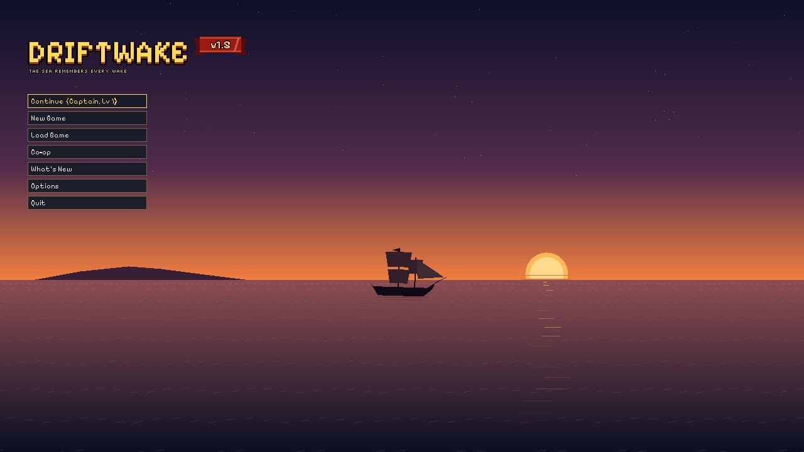

<h1 align="center">Driftwake</h1>

<i>The sea remembers every wake.</i>

  
  
  
  

  A pirate action RPG with a PlayStation 1 look. Sail a living ocean, fight with blades, guns 
  and Will, and make a name for yourself with up to three friends.

---

## About the game

You wake on the sand of Brinehollow, a sleepy fishing island at the edge of dangerous
waters. Make a captain, pick up a cutlass and earn your way off the island. Then take your
sloop out to sea and follow the lodestone down a chain of islands, past pirate fleets, the Admiralty,
reefs, whirlpools, storms and something very large in the deep.

Driftwake is inspired by shonen pirate adventures. Combat is fast and readable, and you build
a fighting style from your weapons, a web of skills and Will.

Nearly everything in the game is themed in a PSX style: the characters, islands, ships,
textures, music and sound effects. It's all rendered like a late-90s console game, with
wobbly vertices, dithered colour and a chunky pixel grid.

## Highlights

<table>
  <tr>
    <td width="50%">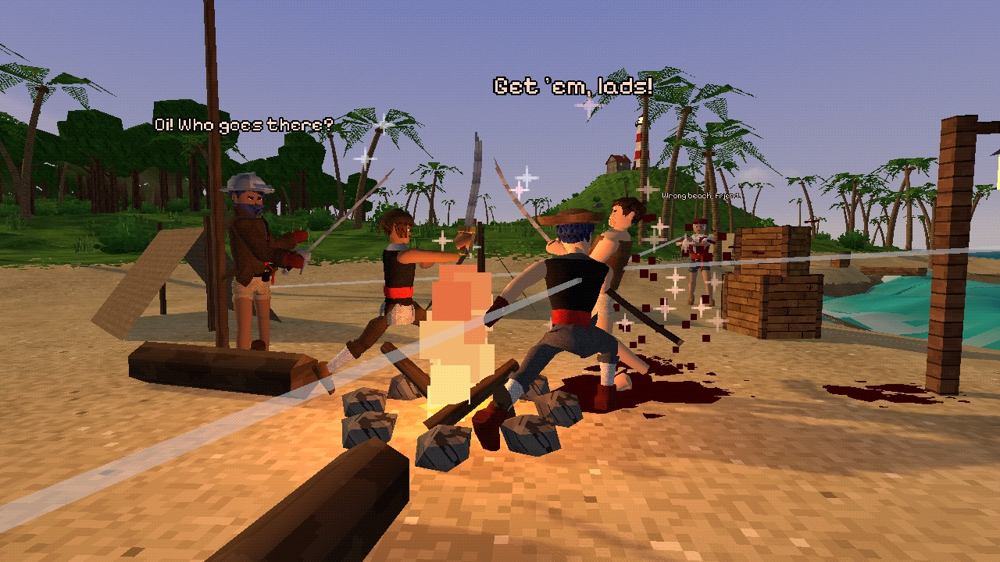 <b>Fight like a shonen hero.</b> Cutlass, katana, axe, pistols and fists, each with its own combo, heavy attack and jump attack. Parry, block, dodge, and break red wind-ups with Will.</td>
    <td width="50%">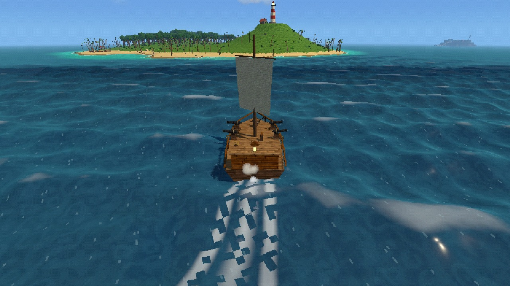 <b>Sail your own ship.</b> Trim the sail to the wind, man the cannons, drop anchor at the capstan, and patch, pump and douse when the hull takes hits.</td>
  </tr>
  <tr>
    <td>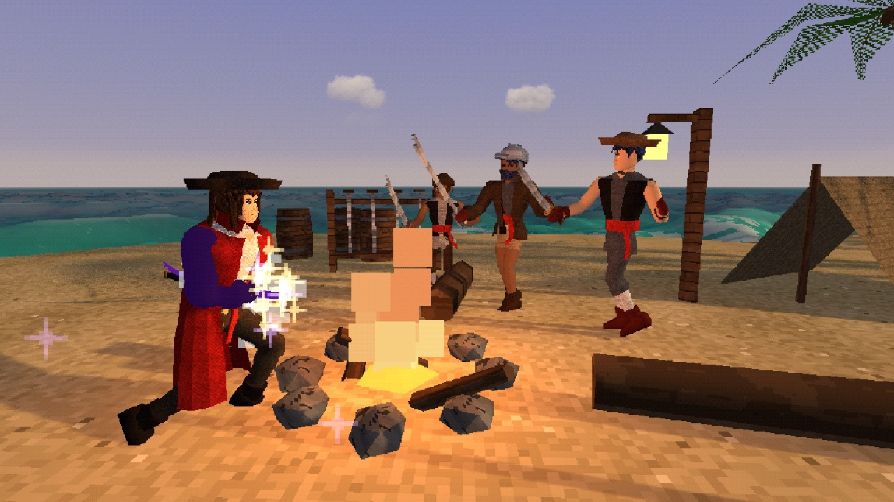 <b>Iron Will and the iai draw.</b> Coat your arm and blade in Will, then hold the katana in its scabbard to charge a single dashing cut.</td>
    <td>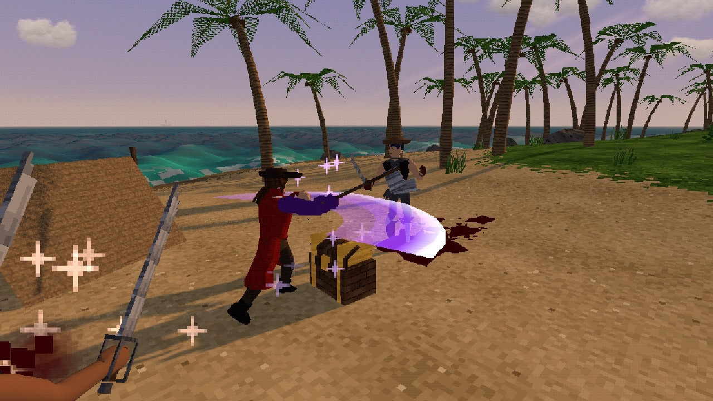 <b>The axe's whirlwind.</b> Right click spins the axe around you, catching everyone in reach and knocking them flat on the second turn.</td>
  </tr>
  <tr>
    <td>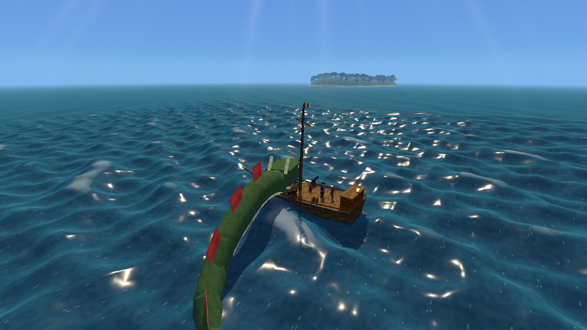 <b>Face the Leviathan.</b> A serpent lurks in deep water. Jump its tail slam, cut at its head when it bites the deck, and claim its hoard.</td>
    <td>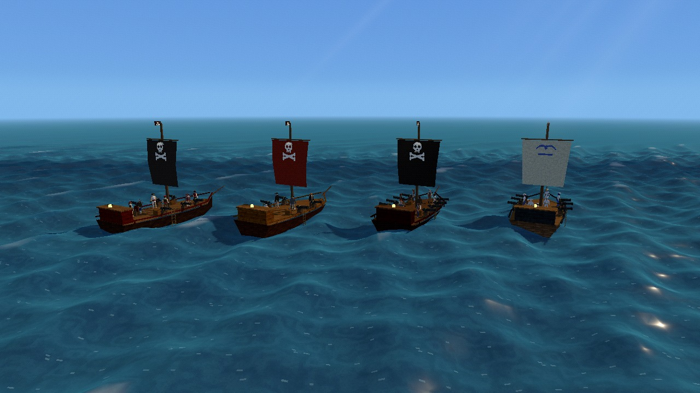 <b>Pirate fleets and the Admiralty</b> that hunt you, fire broadsides, ram, flee and strike their colours. Board them and take their prize.</td>
  </tr>
  <tr>
    <td>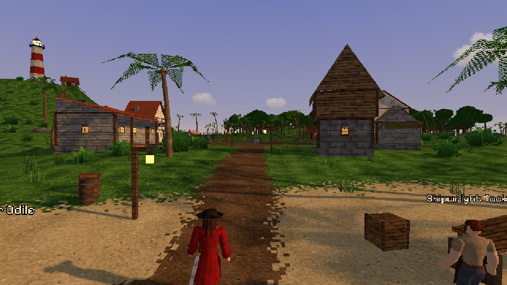 <b>Brinehollow,</b> the starter island: a fishing village, a lighthouse, jungle ruins, a smugglers' camp and traders who buy and sell.</td>
    <td>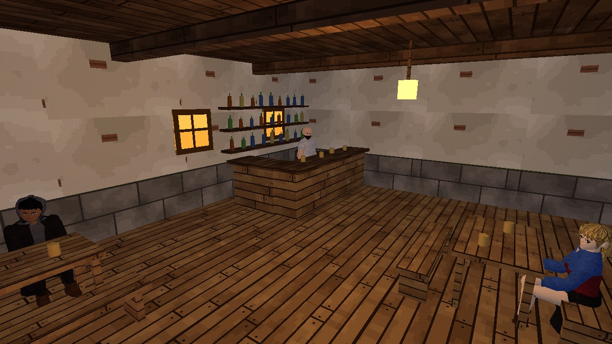 <b>The Salted Gull.</b> Walk into the tavern for rumours, rum and a hot meal from Gus.</td>
  </tr>
  <tr>
    <td>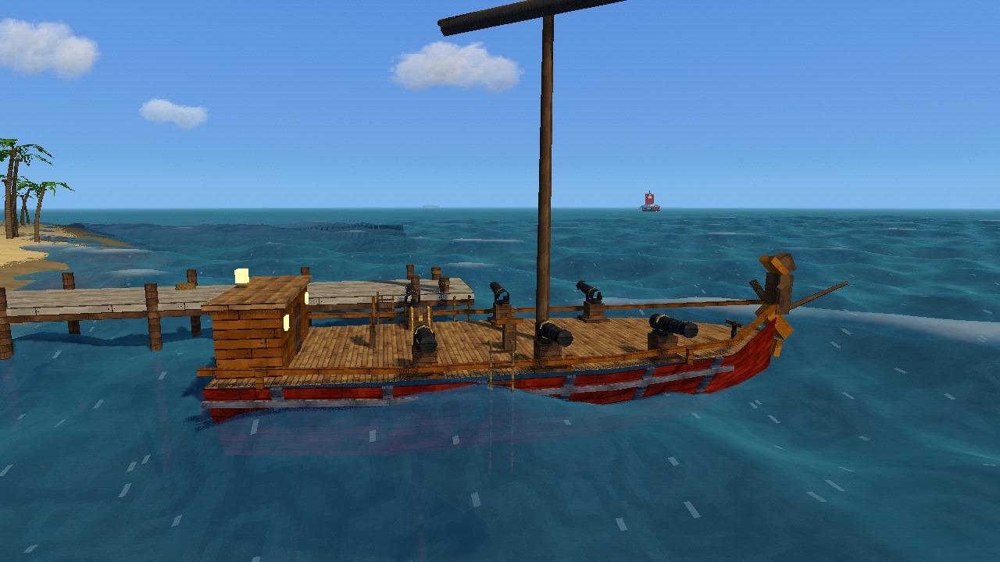 <b>Make the ship yours.</b> Tackett the shipwright refits the hull, guns, sail and rudder, and repaints her with your own flag and figurehead.</td>
    <td>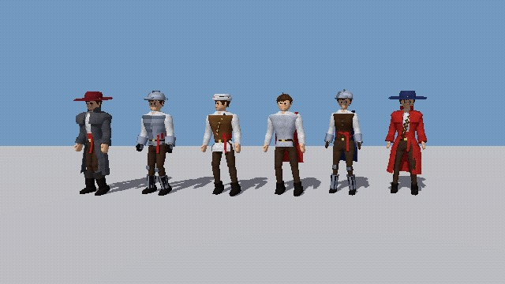 <b>Dress the part.</b> A full character creator, plus hats, coats, capes and armour in seven tiers, from Common to Supreme.</td>
  </tr>
  <tr>
    <td>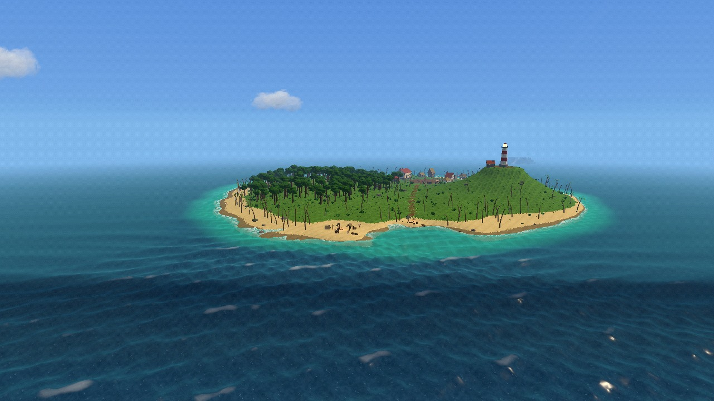 <b>An open sea of islands,</b> with turquoise shallows, wrecks to loot, messages in bottles and treasure to dig up.</td>
    <td>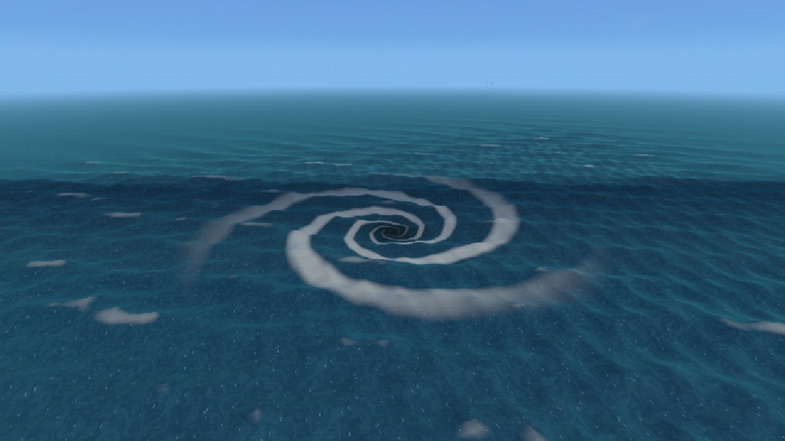 <b>A dangerous ocean:</b> reefs that hole the hull, fog banks, drifting storm cells and whirlpools that drag the sea itself down.</td>
  </tr>
</table>

## Features

### Combat
- **Fighting styles set by what's in your hands:** cutlass, dual swords, katana (two-handed,
  with a charged iai draw), axe (a splitter combo, a whirlwind and the Skybreaker leap),
  pistol, dual pistols (gun kata and Gun Rain), and bare fists (a boxing stance).
- **Parry, block and dodge.** A well-timed parry staggers. Red "peril" attacks can't be
  blocked, only dodged, or broken with Iron Will.
- **Physics ragdolls, blood and dismemberment.** Heavy hits knock people flying, and a katana
  can cut a cannonball in half.
- **Skill trees (K):** a tree for every weapon, Base & Will and your Driftfruit. Weapon trees
  grow with mastery, and mastering a tree wakes its techniques' element. Put an ultimate on R.
- **Grapples and martial arts:** suplex, throw or giant-swing a pirate into his friends.
- **Enemies:** pirate grunts who circle, feint, shoot and raise the alarm; riflemen; scuttlebugs
  and canopy spitters; Captain Grell's den in the forest; the Brood Queen in her cave; Captain
  Morrow, a three-phase boss at Redtide Rock; and the Leviathan.

### Will
- **Iron Will and Weather Eye** awaken at level 10, Captain's Will at level 20.
- **Iron Will: Coat** turns your weapon arm and blade glossy black: nothing can block you, and
  every hit breaks red wind-ups.
- **Weather Eye** makes enemy wind-ups flash, widens your parry window, and with Foresight
  dodges the next hit for you.

### The sea
- **Wind and sailing:** sail where you like; a fair wind gives you extra speed. A braced yard,
  foam wakes and a swell that rolls the hull.
- **Naval fights:** enemy ships show their hull over the masthead; up close their guns won't
  bear, so they ram you or come alongside to board.
- **Ship damage:** cannon hits hole the hull, set fires and flood the ship. The crew patch,
  douse and pump to keep her afloat.
- **A sea you can hear and see:** surf on the shore, the open swell, the hull's wash and
  creaking timbers, gusting wind in the rigging; surf rolling over the shallows, whitecaps
  in a blow, wind streaks and spray over the bow.
- **The lodestone (hold H):** Captain Morrow's glass points to the next islands of the chain.
- **Hazards and plunder:** reefs, fog banks, whirlpools, storm cells, wrecks, bottles and buried
  treasure.
- **The sea chart (M)** fills in as you explore. Set your own marks to sail by.
- **Your ship:** climb the rigging to the crow's nest, swing from ropes off the yard. Below the
  quarterdeck is the crew cabin, with a bunk to rest in, a galley to restock provisions and the
  crew's shared storage chest. Ashore, hold B and she fades in and sails up to the nearest shore.
- **Death:** you wake in the cabin. Your bag waits on a grave where you fell. Die again before
  you get back to it and the grave sinks into the ground, with everything in it.

### Brinehollow
- **A story to start:** wake on the beach and follow Old Pell's lead to Captain Morrow, with
  your next goal on screen.
- **The island:** a harbour town with a stone quay, a village with a tavern, smithy and sea
  chapel, a lighthouse, jungle ruins, the smugglers' camp, a deep western forest and the
  brood cave.
- Traders who buy and sell: Nessa (treasure), Gus (food and drink), Marlo, Clothier Sela,
  Old Ida, Vey's Armoury, and Tackett the shipwright.
- **Item tiers:** Common, Uncommon, Rare, Epic, Legendary, Ultra and Supreme.
  Better tiers hit harder and guard better.
- 27 weapon designs, plus clothing and armour you can buy or find as plunder.

### Your captain
- A character creator with body, face, hair, hats and outfits. Hair, coats, capes and skirts
  move with physics.
- **Levels and skill trees,** with abilities that grow into new tiers the more you use them.

### World and co-op
- **A day/night cycle and weather:** sun and moon, clear skies, rain, storms with lightning,
  and 3D clouds you can fly through.
- **Co-op for up to four captains,** sharing one ship. Revive downed crewmates, and share
  loot and trades.
- **Saves:** three save slots with autosave.

## Controls

| Action | Key | | Action | Key |
|---|---|---|---|---|
| Move | W A S D | | Inventory | Tab / I |
| Sprint | Shift | | Skill trees | K |
| Jump / double jump | Space | | Sea chart (click to mark, C to clear) | M |
| Dodge | Left Ctrl | | Ping a marker | G / middle mouse |
| Light attack | Left click | | Ready / sheathe weapon | Z |
| Heavy attack | Right click | | Pause menu | Esc |
| Parry (tap) / block (hold) | Q | | Zoom camera | Mouse wheel |
| Interact, talk, man a gun (hold for deck jobs) | F | | Pixelation / dither | F2 / F3 |
| Skills | 1 – 5 | | Fullscreen | F11 / Alt+Enter |
| Ultimate | R | | Summon your ship (hold) | B |
| Eat / drink (hold for the item wheel) | E | | Read the needle (hold) | H |
| Weapon loadouts (hold for the wheel) | X | | Belt lantern | L |
| Action wheel: camp, cook, train, fish... (hold) | N | | Crew journal | J |
| Crew chat (co-op) | Enter | | Feral fruit: shift form | V |

The map (M) unrolls in your hands; scroll to zoom from the island out to the sea chart.

**At the helm:** W/S set the sail, A/D steer, left click fires a broadside, F leaves the wheel, and N lashes the helm.

**In the water:** Left Ctrl dives (hold to go deeper), Space surfaces, Shift for a burst. **Fishing:** with a rod in
the equipment slot, face the water and press F to cast, then F again when the bobber dips.

**Climbing ladders and rigging:** F grabs on, W/S climb, Space jumps off, and F lets go. With a
one-handed blade, Z draws it and left click chops while you hang on.

## Version history

Versions marked **unstable** are early builds for trying new things: newer, but less tested. The main download is
always the last stable version (v1.20); unstable ones are on [the releases page](https://driftwake.fun/releases/).

### v1.20.2: The Palace (October 24, 2026), unstable
The palace opens. The grounds' gate stands open and the road up the hill is a road you walk (its ends ramped, its
parapets keeping you on it), up to a new gate in the hilltop's ring wall, the court between the palace's wings, and
the throne hall: columns, a carpet to the dais, banners, chandeliers, Queen Ilsabet on her throne. Lord Chamberlain
Orme's three errands, each after the last: a petition sealed by the Guild, the Queen's stolen signet found on the
docks, and an audience with the Queen. People in raised rooms now stand on their floors.

### v1.20.1: The Docks and the Terrace (October 24, 2026), unstable
The first piece of 1.21, the cities. The royal capital opens beyond its core: a warehouse row east of the market
street leads to the docks' wharf and a postern onto the quay, with Marta Coyle's shipwright's yard (every refit
Tackett's yard does), Haskett's Chandlery (timber, canvas, iron) and Vesper's Corner, a fence who pays over the odds
for plunder. Under the palace wall, the noble quarter's garden terrace of cypresses and hedges, with Ashgrove &
Daughters, outfitters to the court (rare gear a tier above). Two new city quests: a foreman's lost manifest and a
lady's invitation carried to the Crown and Compass.

### v1.20: The World (October 24, 2026)
Every beast boss and roamer reworked: eight rebuilt bodies on a rig with jointed legs and bodies that follow the
slope, each beast with its own move list, readable wind-ups and an opening after each big move, and only one move
that knocks you down. A boss ground for every island type: the jungle's canopy, an ice grotto on the snow, a
half-buried ruin in the desert, a grove of standing stones in the forest. The fifth island type, the fog isle: deep
woods of giant twisted trees, a cursed fishing village, drowned crews that get back up, ghosts that shot passes
through, lanterns that push back the fog, and the Drowned Captain on his wreck. More along the ways between places
(trunks, boulders, old walls, shrines, lone chests, left camps, more creatures and people), each island type's own
roofs and walls throughout, a campfire that looks like fire, and Driftwake's own names for its powers, places and
factions: Driftfruit, Will, the Leviathan, the lodestone. Everything from the v1.19.1-1.19.4 unstable builds.

### v1.19.4: Polish (October 24, 2026), unstable
A pass over every island type. Pirate camps, watchtowers, gates and wells take each island's own roofs and walls
(green shingle in the snow, adobe in the desert, shingle in the forest and the fog) instead of jungle thatch; desert
wharves get adobe warehouses; villages are fuller; the fog isle's sea goes grey under its fog; the Admiralty's ships
are painted grey.

### v1.19.3: The Fog Isle (October 24, 2026), unstable
The fifth island type: a haunted isle under endless fog. Dead woods of bare oaks hung with grey moss, drowned
willows, a grey strand, and a cursed fishing village keeping its lamps lit. Drowned crews hold its camps (bullets
barely slow them, they don't bleed, and they get back up once); ghosts are quick, flicker in and out, and shot passes
straight through them. Light the old lantern posts along its ways to thin the fog and keep the dead out of their
glow; a lit lantern stays lit for the whole crew. Its boss is the Drowned Captain, a ghost who fights like a captain,
calls his crew up out of the ground and steps out of the fog behind you; the isle's other bosses walk as ghosts too.

### v1.19.2: Grounds and Wilds (October 23, 2026), unstable
The next pieces of 1.20. Every island type has a boss ground of its own: an ice grotto on the snow islands (rock
walls sheathed in ice, an overhang hung with icicles, glowing crystals), a half-buried ruin in the desert (a sunken
flagstone courtyard drowned in sand, broken walls, a toppled archway), and an ancient grove of standing stones in the
forest; the jungle keeps its canopy. The ways between places have more to them: fallen trunks, boulders and the
stubs of old walls beside every path, and now and then a wayside shrine, a lone chest or a camp somebody left.
More creatures on every island, and more travellers, ambushes and strangers on the trails.

### v1.19.1: Beasts Reborn (October 23, 2026), unstable
The first piece of 1.20: every beast boss and roamer reworked. Eight rebuilt bodies (the Bear King, a woolly mammoth
Rimeback, the Sand Lion, a lean long-legged Dune Strider, the armoured Thornback, a low frilled Basilisk, and two new
two-legged giants, the Ice Golem and the Elder Treant) on a reworked rig: jointed legs, real gaits, bodies that follow
the slope. Every beast fights by its own move list: readable wind-ups, an opening after each big move, only one move
that knocks you down, and never the same move twice in a row. The Strangler charges right across its arena like a
train; the Sand King no longer chains its dives.

### v1.19: Wanted (October 23, 2026)
Rival captains run by the game, built like yours: the same weapons, moves, skills and ultimates, reading your spacing,
blocking, rolling and punishing whiffs. Four rival crews (the Gilded Gulls, the Brine Wolves, the Lantern Saints and
the Mudlark Brigade) turn up on chain islands for a meeting, then duels: alone you face one or two of their best
matches for your style, then their captain; in co-op each captain gets a rival in their own style. The rest of the crew waits off to
the side at their own work (drilling, reading, tinkering, playing an instrument, sitting) or watching the fight.
They remember who won and come back stronger. A knockdown is never a loss: only being beaten is. A cutscene system
(letterboxed subtitles, voice blips, a co-op skip vote). Bounties for each captain with wanted posters, townsfolk who know your face and shops that change their prices; the Admiralty as grey
ironclad patrols, bounty hunters ashore and three named officers with squads. Lose to the Admiralty and break out of
their brig. A new opening: a narrated storm at sea and a fight on Captain Maren Holt's deck. Fighting in the water
with your own weapon, and spear, hammer, greatsword, twin-axe and black-leg pirates on the chain islands.

### v1.18.4: Masters of the Craft (October 22, 2026), unstable
Skill points made simple: one Combat pool from Captain levels, spent on any weapon's tree, and one Adventure pool;
everything in a tree is bought, and a weapon's mastery decides what you may buy. A lighter skills menu (locked trees
hidden, details on select) with Captain and Will pages. Mastered guards: a second stance for the katana, cutlass,
dagger, dual swords, twin daggers and axe, toggled once owned. Drawn awakenings for the axe, daggers, dual swords,
twin daggers and corsair. Two new techniques each for the polearm, hammer and twin axes (among them Thunder Javelin,
Windmill Guard, Ravens' Return and Raider's Haul). The air step redone as an upright air walk, a tumble after a long
fall, and Acrobatics' Breakfall, Skyward Dash, Sky Leap, Moonstep and Crash Landing. Fists reworked into heavy
straight punching. Perfect Parry and Guard Style in Defense, Surface Sprint in Swimming.

### v1.18.3: New Ways to Fight (October 21, 2026), unstable
Five new weapon kinds, each with its own stance, moves, three-branch tree, element and ultimate: polearms (spear,
trident, naginata, bisento, halberd, pitchfork; lightning), hammers and kanabo (earth), twin axes (frost), greatswords
(wind; a low guard and a charged overhead) and Black Leg kicks (heat; taught by Gus at the Salted Gull, with
hand-planted spins). A stance pass gives every weapon its own guard, run and breathing: a side-on cutlass, a
reverse-grip dagger, a pistol at low ready. Mastery stances: Whitebeard's planted polearm, hands in pockets for Black
Leg. Full Xbox controller support: right-stick look, LB skills, the radial wheels on the stick, and prompts for the
device in use.

### v1.18.2: Every Wake a Lesson (October 20, 2026)
Skills rebuilt from the ground up. Each weapon has its own tree in three branches that grows only while you fight
with it: moves, techniques and its element come by themselves at their mastery level (1-30), stat steps are bought with
the points each level gives, and choices are versions you own both of and switch at the ship's bunk. Your captain grows
stronger every level, with milestones (Squall Step, a third loadout, Ballast, a fourth passive slot) and a talent every five
levels; Will (armament, sense, foresight, the captain's will) comes from beating great foes. Adventure trees for
sailing, swimming, cooking, fishing, acrobatics, defense, stealth and tinkering appear the first time you earn them. One
skill bar across your weapon loadouts (using another weapon's skill switches to it), three passive slots and a library;
new menus, dialogue and round wheels in a hand-made seafaring look; and a performance pass (islands built off the main
thread, no freezes when an island is let go or a fight starts, occlusion in towns). Old captains keep their mastery and
get their points back.

### v1.18.1: A First Look at the Capital (October 20, 2026)
A sneak peek at the first real city: the chain's first city stop, two islands out from Brinehollow, is a walled royal
capital (Port Solenne, Highcrown or Meridian, rolled per world). A harbour with a lighthouse and fort, a sea wall with
towers, a palace on its hill; the market street and plaza with shops and a curio dealer's rare stock, the Crown and
Compass inn, a notice board and city quests, the palace gate and the arena's walls (closed for now), Gallows Row's
toughs, and the busiest crowds in the game, the same for the whole crew. The rest of the city comes in v1.20.

### v1.18: Charted Waters (October 19, 2026)
Everything you do makes you better at it: reworked skills, a real economy, food and fishing, diving, a map you hold
and a journal for the crew.
- **Skills:** fewer, bigger nodes; a shared Captain tree on level points, weapon trees by use, a quarter of the mastery
  shared within a weapon family; life skills (Swimming, Seamanship, Cooking, Fishing) with milestone perks; old
  captains get every point back once.
- **Economy:** much scarcer loot, rolled per captain in co-op; one price curve; named weapon traits from blue up that
  change a move; shops as trades with daily stock, buy-back, rare gear only at treasure merchants, artisans on islands.
- **Food:** regen after a fight, food and drink in one (E, hold for the wheel), ingredients cooked in the galley or at a
  campfire into meals with 10-20 minute buffs; no free galley restock.
- **Fishing:** four rods, four baits, a cast-wait-strike minigame on the real waves, 21 catches from common to legendary
  by water, island and hour, Fishing perks, a legendary recipe.
- **The sea:** diving with a breath meter for chests, oyster beds and reefs; rip currents, surf, swell and cold water;
  sharks, morays and jellyfish; new strokes and climbing out; a tired swimmer floats instead of drowning.
- **The held map** (M): a parchment in your hands, fog over unexplored ground shared by the crew, ? marks, a zoom out to
  the sea chart.
- **Quests and people:** the crew journal (J), notice boards, multi-step quests handed back to their giver, rewards that
  aren't XP, villagers' own lines, ten kinds of island encounters.
- **At sea:** lash the helm and train, read, tinker, fish or sleep; the first Blender-made animation clip.
- **Controls:** abilities on 1-5, loadouts on X, the action wheel on N, making camp, an equipment slot with a show box,
  crew chat (Enter), shift+click stacks, no auto-equip on pickup.
- **Ships:** yard ropes as an upgrade, the rope wins the prompt mid-jump, enemy crews board.
- **Performance and fixes:** smoother towns and island loads; steadier co-op joins; the sprint jump costs stamina; the
  stern's corners closed.

### v1.17: Timber and Tide (October 17, 2026)
Forest islands join the chain, the sloop becomes a ship you build up, and Brinehollow grows into a real town.
- **Forest islands:** autumn woodland of maples, oaks, beeches, birches and firs, rolling hills, rivers that fall into
  gorges; a lumber town on its river with a water-wheel sawmill and a log flume, charcoal camps and a hunter's lodge; a
  waterfall gorge with a cave and rope bridges, a ruined castle with a keep to climb, a hollow giant tree with a root
  cavern. Red deer, foxes, will-o'-wisps, wood sprites and walking stumps; the Stag King and the Elder Treant, the moss
  golem, the Cursed Huntsman and his hounds, the Wild Hunt at night; its own day and night music and woodland ambience.
- **Ship upgrades:** Tackett's refits are twelve levelled lines, every level visible on the sloop (plating, gun deck,
  sails, rudder, copper bottom, bow chaser, crow's nest lookout, lanterns, railings, tangerine grove, galley and bunks,
  the hold); higher levels need salvage (timber, iron, canvas, copper) from sunk ships, wrecks and chests; any captain
  can chip in; old refits carry over.
- **Seamanship:** each captain's own SEA tree, earned at the helm, the guns, repairs and the pump, with bonuses at the
  station you man.
- **Brinehollow:** the island grew south (farmland, a windmill hamlet, a waterfall pool, a wreck, a second cove); a
  market street of shopfronts, a second row of houses on the hill, a shrine terrace and pagoda up a long stair, woods
  all round the town; shopkeepers on routines, a busy Salted Gull at night, lanterns across the market street, chimney
  smoke, town sounds, fishing boats and dockers at the harbour. Haldor's Forge sells the weapons, Corin instruments,
  Vey armour.
- **Doors and steps** on every building, walkable (the lighthouse and harbour tower too); roofs without the dark seam
  or buried chimneys.
- **The katana:** the combo, the air slash and all five skills on the blade's real path, drawn steel slashes, a
  steel-blue cloud and sakura awakening, a petal aura on the blade.
- **Fixes:** co-op guests' clocks settle right after joining; test and render windows no longer go fullscreen.

### v1.16: Sand and Snow (October 17, 2026)
The island chain goes past the jungle: it now rolls jungle, snow and desert islands, each with its own land, towns,
people, wildlife, bosses, weather and music.
- **Snow islands:** a tall peak with spires, frozen lakes and a frozen river, a summit castle on most; round pink-brick
  villages under tiered green roofs, snowy fences, iron lamps and a tame shagback by the market; ice-block ruins, a
  buried town, a ship frozen in the pack ice, ice caves with icicles, crystals and a frozen waterfall. Wolf packs,
  white bears, walrus colonies, snow hares and shagback herds; the White Shade, the Bear King and the Ice Golem,
  Frostfang and the roaming Rimeback.
- **Desert islands** (the biggest yet): plateaus, mesas, ridges, dune fields, wadis, canyons, salt pans and oases;
  pastel flat-roofed towns with domes and awnings, packed medinas with minarets and a great domed hall, rooms to walk
  into, the caravanserai and the potter's; caravan camps, an obelisk, twin guardians, a ruined skyline, a buried city
  and a tomb in the cliffs. Scorpions, monitor lizards, fennec foxes and vultures; the Sand King, the Dune Emperor, the
  Basilisk and the Sand Lion, a hyena alpha, the Dune Strider and a bandit chief leading the pirates' camp.
- **Weather by island:** a snow island's white haze, constant light snow, heavy snow and blizzards; a desert's
  sandstorms instead of rain (lamps light against them); no lightning where it doesn't rain.
- **Footprints** in snow and sand that fade, a soft snow layer your boots sink into, snow and sand kicked up as you
  walk, snow and ice footsteps, breath in the cold; footsteps on every generated island read the real ground.
- **Music:** desert and snow tracks for the wilds and the towns, each with a night version; wind, sandstorm and
  blizzard beds.
- **Effects:** a library of hand-drawn sprite effects drives the smoke, dust, sand, snow, mist and blood; fire and
  explosions throw a brief light. Kraken's Wake (the cutlass's ultimate) is redrawn in flowing ink-style water, and
  Call of the Tide winds water round a drawn cutlass.
- **Capes and the cloak:** capes are a tattered trapezoid with painted folds and keep off the legs; Sela sells a heavy
  cloak; the belt lantern hangs at the hip.
- **Fixes:** minibosses now turn up on every kind of island; a few chain seeds no longer fail to name their islands.

### v1.15: Cliffs and Currents (October 15, 2026)
- **Grell's cliff path:** a ledge cut into the den's sea cliff (cable railings, overhangs, moss), about twice the old
  climb, with five gaps over the sea (a sand ramp to swim back), a bug cave (scuttlebugs, ceiling spitters, a cave
  brute), and a broken bridge crossed on a hanging chain. Grell holds by his fire until a captain is close; his pier
  ladder stays rolled up until someone reaches the top once (saved, shared in co-op).
- **Shore-aware water:** each island bakes a shore map; the swell fades to nothing at the waterline (no more sea
  through the sand) and turns to run in along the beach, steepening as it shoals; lee coasts are calmer. CPU and GPU
  share one wave function.
- **Flipbook effects (pilot):** sprite-sheet smoke and explosions on the ship's cannon (muzzle smoke, hull fireballs,
  sea plumes) and dust clouds on heavy hits and knockdowns.
- **Swings keep momentum** when you let go (vines, ship ropes, the chain).
- **Game time everywhere:** sprint shake, the marker cooldown, thunder's delay, villager barks, bobbing markers and
  bottles, and the solo weather clock no longer use the wall clock. A release performance gate and a wall-clock check
  guard against regressions.

### v1.14: Smooth Sailing (October 15, 2026)
The performance update: the last few releases had slowed Brinehollow to 20-30 fps; it now runs about 4.5x faster.
- **Far actors sleep:** pirates, bugs, spitters, enemy ships and villagers past ~160 m from every captain stop
  thinking, moving and animating, and wake within ~120 m where they were (villagers back on their routine); co-op aware.
- **Fewer draws:** a body is ~15 surfaces instead of 23, kit pieces get visibility ranges by size, small things stop
  casting shadows, sun shadows reach 80 m, fog banks are one MultiMesh each.
- **Calmer physics:** hurtboxes and interactables no longer monitor (6 of 720 areas do), moored hulls rest far off,
  at most 4 physics steps a frame; Weather, birds, clouds, coast checks, spray and puddles update less often.
- **Measured** (dev laptop, Brinehollow route): 42.3 -> 9.2 ms a frame at midday (~24 -> ~108 fps), 35.9 -> 9.3 at
  night, 32.1 -> 10.1 in rain. The F8 overlay shows enemies awake / asleep.
- **Also:** stance and parry polish (twin daggers, one dagger, dual swords, with parry flourishes), arms no longer
  stretch after knockdowns or hand-placed weapons and instruments, combo/reload/input-buffer timing in game time,
  nothing kills a duelist mid-duel.

### v1.13: Shore Leave (October 15, 2026)
Things to do with your crew when nobody's trying to sink you.
- **Instruments:** tin whistle, bodhrán, concertina, fiddle and hurdy-gurdy, sold by Gus at The Salted Gull and
  chain-island traders (never a starting item), worn in a new INST slot and played from the emote wheel (T).
- **Jamming:** four original shanties with a part for every instrument, on the host's clock; start near a crewmate
  who's playing and you join their tune at the same spot. The music dips while anyone nearby plays.
- **Player menu and duels:** F next to a crewmate opens Trade, Inspect and Duel; a duel shows the opponent's
  health as a boss bar, only the pair can hurt each other, the loser is downed (nothing lost), both stand up healed,
  and the winner earns a little XP.
- **Sound:** impacts by weapon (slice, chop, punch, shot, a steel clash on parries and blocks) and a UI sound set.
- **Fixes:** the solo swell runs on game time (it jumped after a hitch); emotes no longer play music.

### v1.12: Night Watch (October 14, 2026)
Light, music and a living sea.
- **Light:** moonlit nights you can see in (a floor for storms), lanterns on your ship and pirate ships, more
  lamps, lit windows and doorways in towns, villages and harbours, and a belt lantern on every captain (lit at
  dusk, swings as you move, L toggles it, out when you swim; mirrored in co-op).
- **Music:** a new title theme and 2-2.5 minute pieces for the sea, the island wilds and villages, each with a
  night arrangement that crossfades in step; music dips under cannons and roars.
- **Sea and sky:** bow waves, slaps and sheets of spray, surf breaking by coast (beach, rock, quay), spindrift,
  foam patches and splash rings; a layered ocean (deep swell, lapping, far breakers, gusts) muffled underwater;
  gulls, flocks and parrots that perch and scatter.
- **Rain:** dimmer, lit streaks that stop and splash on ground, roofs and decks, puddles that soak in and dry,
  rings on the sea.
- **Also:** days run longer than nights (14 minutes of daylight to 10 of night), pixelation is one on/off option
  at the sharper grid, and the lodestone moved to H.

### v1.11: Sea Legs (October 13, 2026)
The feel update.
- **Moves:** standing, running and sprinting jumps, a somersault double jump, a snappier dash, the lodestone
  held properly, and every weapon's own draw and sheathe with 13 new sounds (axes on the back).
- **Healing in a fight:** quick-slot food, rum, stew and the new Sea Tonic on an 8 s shared cooldown, eaten or
  drunk over a moment; a hit spills it.
- **Sitting, sneaking, emotes:** sit on benches, stools, logs and crates (F) or the ground; crouch to sneak (C);
  an emote wheel of twelve (hold T), all mirrored in co-op; gestures when talking, trading and opening things.
- **Clothing:** clipping fixed between coats, vests, belts and armour, and nine new pieces (admiral's coat,
  cavalier boots, slouch hat, spyglass...).
- **Every screen crisp:** skill map, shops, dialogue, chart, yard, save slots, creator and HUD on the
  inventory's whole-number-scale canvas, with tooltips.

### v1.10: The Living Isles (October 13, 2026)
The biggest update yet, and a milestone: every island is now its own adventure, with enough out there
for a properly fun, replayable game.
- **Harbours:** stilt ports, smugglers' coves, wharves, old harbours and bare landings.
- **Villages:** towns, hamlets, walled trading posts, stilt villages and ruins, with shops and homes
  to walk into.
- **Villagers with routines** (work, lunch, the inn, home), named locals with rumours and quests.
- **Caves and dungeons** (seven kinds, one to three per island) and a ruined temple on some islands.
- **The jungle grown up:** six forest kinds, giant canopy trees, thick undergrowth, landmarks and a set
  piece per island; **new coastlines** with sea cliffs and wadeable sandy shelves on every island.
- **Jungle bosses:** the Silverback in the canopy, the Strangler, the Shade, the Mantis Queen, an alpha
  boar and the roaming Thornback; **creatures:** boars, crabs, snakes, monkeys, toucans, bats, bugs.
- **Daggers:** one or two, bleeds and backstabs, three ultimates; the off hand holds one reversed.
- **Tougher fights:** gap closers for the brood queen, Grell and Morrow, lingering poison, the
  rifleman's shove telegraphed, smarter pirates and elites that dodge.
- **Brinehollow:** Grell's den moved to a clifftop out of sight of the beach, with a climb to reach it.
- **The second wardrobe:** 23 new pieces of clothing and armour (hats, tops, vests, coats, gloves, legs,
  feet, belts, accessories), sold by Sela and Vey or found as plunder.
- **A fresh coat of paint:** a new palette (cream, teal, coral, sunflower) and rounded, gilded pixel
  frames on every menu, the shipyard, the character builder, the HUD and the website.
- **Inventory refresh:** held items leave the bag, tooltips with comparisons, crisp text; option arrows
  step back too.

### v1.9: Beasts and Blades (October 12, 2026)
- **The beasts rebuilt:** the Silverback is a real gorilla, and the Leviathan a long serpent that
  circles your ship, rears over the deck and bites.
- **Sword and pistol:** the Corsair style. Blade and pistol in one combo, Powder Lunge, Dead Man's
  Drop and Powder Finale, a butt-strike while reloading, and its own skill tree with an ultimate.
- **Dual wield:** fixed and polished. A sword with a second sword, an axe or a dagger, the off hand
  changing the weight of each hit, and Twin Spin in the tree.
- **Driftfruits rest for now:** chests no longer hold them while their powers are reworked. Fruits
  already eaten stay yours.
- **Co-op:** a pistol shot fired across your own body no longer vanishes, and a guest reaching an
  island that's still building keeps its fights.
- **Brinehollow as a kit:** the starter island is built from reusable pieces, the first step to
  giving every chain island its level of detail.

### v1.8: The Chain (October 9, 2026)
- **The island chain:** past Redtide, the lodestone leads to islands generated from your world's
  seed. Jungle isles have a pirate camp and its named captain, a bug lair, ruins and a summit lookout,
  and each one is tougher than the last (enemies scale with the island's level).
- **Outpost villages:** an inn, a trader and a cook, a job board and an elder on every island.
- **The Silverback:** each jungle isle's beast, with its hoard and the Silverback Pelt.
- **Reading the lodestone:** needles on the compass, each island's theme and danger, forks you
  pick by sailing, and a chart that follows you along the chain. The needle settles after 15
  minutes on an island, or as soon as its beast falls.
- **The sea between:** pirate fleets of the next island's level, hazards, Leviathans, wrecks,
  bottles and islets on every leg.
- **Combat:** the katana and the axe reworked (Thousand Petals, Maelstrom, Earthsplitter), and
  jumping attacks for every weapon.
- **Sound:** layered hull wash that follows your speed (no more short loop), footsteps by surface,
  varied hits and shots, and island music that resumes after a fight.
- **Pacing:** slower levelling, weaker long-range pistols, faster and fiercer pirate ships.
- **Co-op:** guests see boarders, and late-built islands catch up on fights.
- **In the browser** at [driftwake.fun](https://driftwake.fun) (co-op stays on desktop).

### v1.7: Wind and Story (October 8, 2026)
- **A story to start:** wake on the beach past the quay and follow Old Pell's lead through
  Brinehollow to Captain Morrow, with your next goal on screen and a marker to follow.
- **Brinehollow grows:** a deep western forest, Captain Grell's pirate den, spitters in the
  canopy and the Brood Queen's cave.
- **The harbour town:** a stone quay with piers, trading ships and a harbour tower; the village
  gets dressed houses, a furnished tavern, a cobbled plaza, a smithy and a sea chapel.
- **Morrow's lodestone:** hold L to see where the islands of the chain lie.
- **Combat:** a new cutlass combo and polished techniques (the Kraken's Wake), elements woken
  by weapon mastery, and heavy attacks that tire you when spammed.
- **Fairer sea fights:** enemy hull bars, far fewer holes, faster pumping, and ships that ram or
  board up close instead of firing. The wind only ever helps.
- **Redtide Rock:** the fort's guns are gone; a stone stair, sea stacks and crags instead.
- **Sound and sight of the sea:** surf, swell, hull wash, creaking timbers, gusting wind and
  whistling rigging; surf rolling in, whitecaps, wind streaks and spray.
- **Climbing by hand** and interaction prompts only when you're right next to things.

### v1.6: Trees and Timbers (October 7, 2026)
- **Skill trees (K):** a tree for every weapon, Base & Will and your Driftfruit, grown with
  weapon mastery. Old saves get every skill point back.
- **26 new techniques** (Riposte, Wind Severer, Blade Dance, Deadeye, Smoke Bomb...) and an
  ultimate for every weapon, on R.
- **Grapples and martial arts:** Suplex, Shoulder Throw, Giant Swing, Hundred Fists, Rising
  Dragon and the Leviathan Fist.
- **Ability tiers:** Squall Step becomes Shadow Step, Foresight a stance that dodges for you, Ballast
  hardens you by itself.
- **Cut the bullets:** a parry upgrade that cuts gunshots out of the air, and sends them back
  once mastered.
- **Will:** 17 new passives and Captain's Will at level 20.
- **Bigger ships** with a quarterdeck over a crew cabin, a crow's nest, rigging and swing ropes.
- **Life aboard:** a bunk, a galley and the crew's shared chest; you wake in the cabin when
  you fall, and your bag waits on a grave.
- **Summon your ship:** hold B near the water.

### v1.5: The Open Sea (October 7, 2026)
- **Sailing:** wind and sail trim, an anchor on a chain worked at the capstan, and hulls that
  hole, burn and flood while the crew patches, pumps and douses.
- **Sea hazards:** reefs, fog banks, whirlpools and drifting storm cells.
- **Plunder:** wrecks to loot, messages in bottles and buried treasure.
- **The Leviathan:** a serpent at its lair with bites, tail slams and a hoard.
- **Enemy fleets:** sloops, gunboats, brigs and Admiralty cutters that ram, flee and surrender.
  You can board their ships, and their crews are visible on deck.
- **Navigation:** a sea chart, a compass strip and map marks.
- **Brinehollow's traders and Tackett the shipwright:** refits, paint, a flag designer
  and figureheads.
- **Gear:**
  - Seven item tiers.
  - 27 weapon designs.
  - New armour: cuirass, mail, morion, greatcoat, gauntlets, greaves and capes.
  - Nine more hairstyles, and hats now sit over the hair.
- **New moves:** the axe gets its own moveset, and the cutlass is polished with a running cut.
- **Visuals:** foam wakes, turquoise shallows and rain pooling on deck.
- **Co-op and pacing:** smoother co-op sailing, and levels now take twice the XP.
- **Title screen:** a What's New pop-up and a version ribbon.

### v1.4: Steel and Style (October 6, 2026)
- **The katana:** a two-handed style with a scabbard, a charged iai draw, a running draw
  and an air slash.
- **Pistols:** shots follow the crosshair, dual pistols get the Gun Rain air attack, and gun
  kata works on the move.
- **Blood and dismemberment.**
- **Bodies:** skinned bodies with round knees, elbows and shoulders, and fuller body shapes.
- **Movement:** hip and leg motion, uneven landings, skids and planted stops.
- **Ragdolls:** they no longer slide or vibrate, and they collide with themselves.

### v1.3: Weather (October 5, 2026)
- **Day and night:** a 24-minute day/night cycle with a sky, sun, moon and stars.
- **Weather:** clear, cloudy, rain and storms, with lightning and rough seas.
- **Clouds and light:** 3D puff clouds you can fly through, and god rays.
- **The sea:** waves rebuilt from six wave trains so swimmers and ships ride the waves you see,
  and the sea fades into the horizon.

### v1.2: Pirates (October 5, 2026)
- **Ships at war:** crew-manned cannons and broadsides, plus pirate ships that hunt, fire
  and board.
- **Redtide Rock:** a fort guarded by Captain Morrow, "Red Tide", a three-phase boss.
- **Music** generated for the island, the sea, combat and boss fights.
- **Co-op polish:** pings and crew markers.
- **Inventory:** a loot window, drag-and-drop inventory, and trading between captains.
- **Visuals:** a sharper PSX preset.

### v1.1: Skills and Crew (October 4, 2026)
- **Skills:** a skill bar and energy.
- **Progression:** levels and the skill map, with Iron Will and Weather Eye.
- **Fighting styles:** sword, dual swords, boxing, pistol and dual pistols.
- **Defence:** blocking, red unblockable attacks, fall damage and foot IK.
- **Saves:** a title screen and three save slots.
- **Co-op for up to four captains:** knocked-out crewmates can be revived, and the crew
  shares one ship.

### v1.0: Brinehollow (October 4, 2026)
- **Brinehollow:** a village, a tavern, a market, a lighthouse, ruins and the smugglers' camp.
- **Characters:** a character creator, procedural anime-style bodies, and hair and cloth physics.
- **Gear and townsfolk:** an inventory, gear, and villagers with branching dialogue.
- **Enemies:** pirate grunts (swordsmen and riflemen) and scuttlebugs.
- **Combat:** parries, ragdolls and the plunge attack.
- **The sea:** the sloop, swimming, and the PSX renderer.

### v0.1: Prototype (April 2026)
- The first prototype, "Grand Line Prototype": procedural islands, an ocean, sword combat,
  a ship and loot banking.

## Coming next

- **Chain islands at Brinehollow's level** (built, in testing): harbours and village layouts
  that vary by island, villagers with routines and quests, caves, dungeons and a ruined temple,
  landmarks and set pieces, new jungle beasts and fauna, and new coastlines.
- **New movesets:** daggers (built, in testing), dual axes and a two-handed hammer.
- **New island themes:** snow, desert and forest.
- **New music:** a more adventurous score.
- **A new UI:** detailed pixel-art menus and item tooltips.
- **Real lights** on the ships' lanterns.

The working list is in [docs/todo.md](docs/todo.md).

## Running from source

1. Install [Godot 4.7](https://godotengine.org/download) (standard build, not .NET).
2. Clone this repository and open `project.godot` in Godot.
3. Press **F5** to play. The game opens on the title screen.

To play co-op, one captain picks **Co-op → Host** on the title screen and the others
**Join** with the host's IP address (port 24680).

<b>For developers</b>

 

- **Engine:** Godot 4.7 (Forward+, GDScript, Jolt physics, D3D12 on Windows).
- **Generated assets:** textures, sounds and music come from Python scripts in
  `tools/texture_gen/` (`py -m pip install -r tools/texture_gen/requirements.txt`).
- **Tests and render tools:** headless test suites and render tools live in `tools/dev/`,
  and [tools/dev/README.md](tools/dev/README.md) lists each one.
  Run them with `.\tools\dev\run_tests.ps1 <suite>` and `.\tools\dev\nettest.ps1`.
  These screenshots are rendered at the game's "960x540 (sharper)" PSX preset by
  `tools/dev/readmeshot.gd` and the other render tools (with the `psx` argument).
  `tools/dev/readme_media.gd` lists the commands and copies the picks into `docs/media/`.
- **Design notes:** [docs/dev_notes.md](docs/dev_notes.md) has detailed notes from every round
  of work, and [docs/multiplayer_plan.md](docs/multiplayer_plan.md) covers co-op.
- **Exporting:**
  - Add `data/dialogue/*.json` to *Export → Resources → Filters to export non-resource files*,
    or the NPCs will be silent.
  - Exclude `tools/*` and `docs/*`.
- **Debug keys** (editor builds only):

  | Key | Does |
  |---|---|
  | F6 | Cycle the weather |
  | F7 | Skip ahead 2 hours |
  | F9 | Gain a level |
  | F10 | Knock yourself down |
  | F12 | Save a screenshot and a state dump to `tools/dev/out/captures/` |

| Folder | What's in it |
|---|---|
| `scenes/player`, `scripts/player_states` | The player and its state machine |
| `scripts/npc` | Procedural bodies, the animator, the character creator's looks |
| `scripts/combat`, `scripts/enemies` | Hit boxes, ragdolls, grunts, bosses, the Leviathan |
| `scripts/powers`, `scripts/progression` | Powers, skills, the skill map |
| `scripts/ship`, `scripts/ocean` | Ships, cannons, enemy fleets, the sea and its waves |
| `scripts/island`, `scripts/world` | Islands, Brinehollow, weather, clouds, sea features |
| `scripts/net` | Co-op networking |
| `scripts/psx`, `shaders/psx` | The PS1 look |
| `scripts/ui`, `scenes/ui` | HUD, menus, inventory, shops, the title screen |

